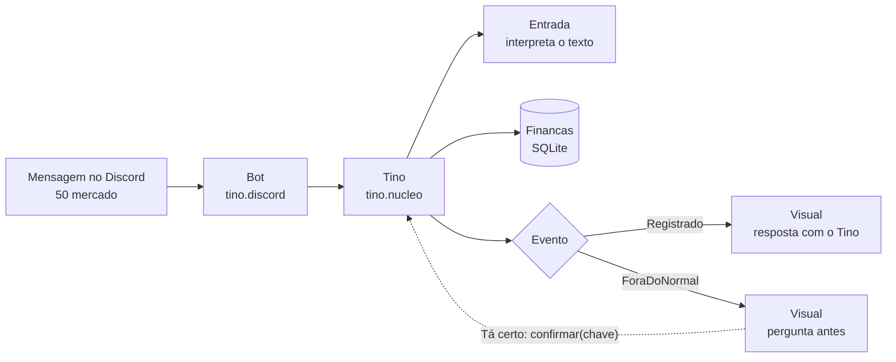

<div align="center">

[](https://github.com/hemkdev/tino/actions)
[](LICENSE)
[](https://discord.com/oauth2/authorize?client_id=1535474778180292628)


</div>

# Tino

Finanças pessoais **por conversa**: você escreve o gasto como falaria e o Tino anota, categoriza e
mostra para onde o dinheiro vai. O nome vem de *ter tino*, juízo. Ele é um brotinho que guarda
moeda, sério com o dinheiro e gentil com a pessoa.

Hoje o canal é o **Discord**. O núcleo não depende dele, e site, Telegram e um conector MCP são os
próximos canais sobre a mesma conta.

## O que é

```
50 mercado
+3000 salário
50 mercado, 30 uber, 12 café
```

Na DM, sem barra e sem formulário. Também vale perguntar: **quanto gastei esse mês?**, **extrato
de hoje**. O que ele não entende recebe o jeito certo de escrever, nunca silêncio, e o status
"Me manda: 50 mercado" ao lado do nome mostra que ele está no ar. Cada lançamento mostra o acumulado da categoria no mês, com botões para desfazer e
editar, e o `/resumo` traz as categorias em barras, a variação sobre o período anterior e a
projeção do mês.

## Os estados

| Anotou | Valor fora do normal | Não entendeu | De madrugada |
|:---:|:---:|:---:|:---:|
|  |  |  |  |
| "Registrado: **R$ 132,40** em Mercado." | "R$ 4.800 em Moradia? Seu normal é 1.800." **[Tá certo] [Corrigir]** | "Não achei o valor. Manda assim: `23,50 uber`." | "Hm… anotado. Vai dormir também." |

No alerta ele **só grava depois da resposta**: o `5000` digitado no lugar de `50,00` não vira
histórico. Toda pergunta vem com botões, e quem julga o gasto é a pessoa, nunca o bot.

## Como funciona



O canal só recebe a mensagem e formata a resposta. Quem interpreta, calcula e grava é o núcleo:
`Tino.lancar` devolve um `Evento`, que é `Registrado` ou `ForaDoNormal`. Quando o valor passa de
5× a média recente da categoria, o núcleo guarda o pedido como pendente e o canal pergunta antes;
a resposta volta por `Tino.confirmar` ou `Tino.descartar`. Um canal novo (site, Telegram, MCP) fala só com a classe `Tino`.

## Comandos

| Comando | O que faz |
|---|---|
| `/gasto` · `/ganho` | Registra um valor, com categoria, descrição e data opcionais |
| `/lancar` | Vários de uma vez: `50 mercado, 30 uber, +3000 salário` |
| `/resumo` | Por categoria, com variação e projeção do mês |
| `/lancamentos` · `/exportar` | Lista com os ids · CSV |
| `/remover` · `/categoria` · `/fixo` | Apagar, organizar categorias, lançamentos fixos |
| `/ajuda` · `/help` | Como escrever e o que cada comando faz |

Cada pessoa vê só os próprios dados. O que é guardado e como apagar está em
[PRIVACIDADE.md](docs/PRIVACIDADE.md); as regras de uso, em [TERMOS.md](docs/TERMOS.md).

## Garantias

- **Toda query filtra pela conta.** Sem exceção: ninguém lê o lançamento de outra pessoa.
- **Dinheiro em centavos inteiros.** Nunca `double`: o SQLite não tem decimal, e ponto flutuante
  em dinheiro é bug.
- **Valor estranho não grava sozinho.** Acima de 5× a média recente da categoria, ele pergunta
  antes, e o pedido pendente tem chave aleatória que só a dona confirma.
- **A fronteira é do compilador, não da disciplina.** `Financas`, que tem o SQL, é
  package-private: chamar o banco de fora do núcleo não compila. E o `Evento` é `sealed`: um
  evento novo que algum canal esqueça de tratar também não compila.
- **Data futura é rejeitada**, e o valor precisa ser maior que zero, com no máximo duas casas.
- **Nada de token ou dado financeiro em log.**
- **Testes a cada PR**, contra SQLite em memória, no GitHub Actions (`mvn verify`).

As regras completas e o porquê de cada uma estão em [banco.md](docs/banco.md) e
[decisoes.md](docs/decisoes.md).

## Rodar

Precisa de Java 25 e Maven.

```bash
mvn package
DISCORD_TOKEN="seu-token" java -jar target/tino.jar
```

Os dados ficam em `tino.db` (ou no caminho de `BANCO_CAMINHO`). `DISCORD_GUILD_ID` registra os
comandos numa guild só, o que é imediato; sem ela o registro é global, necessário para a DM.

## Estrutura

```
src/main/java/tino/
├── nucleo/    Tino (casos de uso), Financas (SQL), Entrada, Dinheiro, Evento e os records do domínio
└── discord/   Bot (eventos do JDA), Visual (embeds e botões), Estado
src/test/java/tino/   testes do núcleo e do canal, contra SQLite em memória
docs/
├── decisoes.md       o que foi escolhido, o que foi recusado e por quê
├── banco.md          esquema e regras que não são negociáveis
├── personagem.md     estados, falas e os próximos traços
├── PRIVACIDADE.md    o que é guardado e como apagar
├── TERMOS.md         regras de uso do bot
└── marca/            o Tino em SVG, GIF e PNG
.github/workflows/    CI: lint (javac -Xlint), testes e build da imagem arm64
```

## Limitações

- **Só Discord por enquanto.** O núcleo já é independente, mas site, Telegram e MCP ainda não existem.
- **Ainda não roda numa VPS.** O bot só responde enquanto o processo estiver de pé.
- **Pedido à espera de confirmação fica em memória.** Se o bot reiniciar, ele se perde e o botão
  responde que expirou.
- **Parte das regras é checada só na entrada de texto.** Valor positivo e data não futura são
  validados ao interpretar a mensagem (`Dinheiro`, `Entrada`). Um canal que monte o pedido direto
  ainda não passa por essa checagem.
- **Feito para uso pessoal.** Um processo, uma conexão e um lock. Se um dia houver concorrência
  de verdade, a troca é por um pool, sem mexer na API.

## Roadmap

- [x] Núcleo separado do Discord, com a fronteira garantida pelo compilador
- [x] Personagem nas respostas e alerta que pergunta antes de gravar
- [x] Regras no núcleo: pendentes que sobrevivem a reinício, relógio e fuso únicos
- [ ] Traços do personagem: planta, ausência, impulso, vigiar categoria
- [ ] Site e conector MCP sobre a mesma conta
- [ ] No ar numa VPS

## Créditos

A técnica de animação do personagem (camadas em SVG, com cada estado animado por CSS) veio do
estudo do [LabDots](https://github.com/vitorcgo/LabDots), de Vitor Cavalcante, licenciado em MIT.
O código daqui foi escrito do zero sobre essa ideia.

## Apoie

Se o repo te ajudou, deixa uma ⭐. Valeu :)
