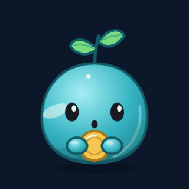
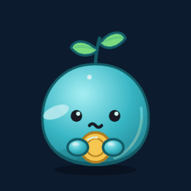
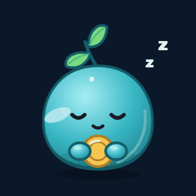

# Tino

Finanças pessoais por conversa, em Java. Você escreve o gasto como falaria e o
Tino anota, categoriza e mostra para onde o dinheiro está indo.

O nome vem de *ter tino*: juízo, discernimento. Ele é um brotinho que guarda
moeda, **sério com o dinheiro e gentil com a pessoa**.

```
50 mercado
50 mercado 07/08 pão e leite
+3000 salário
50 mercado, 30 uber, 12 café
```

Sem barra, sem formulário. Hoje o canal é o Discord; o núcleo já não depende
dele, e Telegram, site e um conector MCP são os próximos.

## O personagem

|  |  |  |  |
|:---:|:---:|:---:|:---:|
| anotou | valor fora do normal | não entendeu | registro de madrugada |
| "Registrado: **R$ 132,40** em Mercado." | "R$ 4.800 em Moradia? Seu normal é 1.800." | "Não achei o valor. Manda assim: `23,50 uber`." | "Hm… anotado. Vai dormir também." |

Cada reação responde a algo que aconteceu de verdade, não é enfeite. No alerta, ele
pergunta com **[Tá certo]** e **[Corrigir]** e só grava depois da resposta: o
`5000` digitado no lugar de `50,00` não vira histórico. Estados, regra das falas
e próximos traços em [`docs/PERSONAGEM.md`](docs/PERSONAGEM.md).

## Usar

**[Adicionar o Tino](https://discord.com/oauth2/authorize?client_id=1535474778180292628)**

Instale na sua conta (*Add to my apps*) e abra uma conversa com ele. O primeiro
comando já cria suas categorias iniciais. Comece com `/ajuda`.

Cada pessoa vê apenas os próprios lançamentos. O que é guardado, onde fica e como
apagar está em [`docs/PRIVACIDADE.md`](docs/PRIVACIDADE.md).

## Comandos

| Comando | O que faz |
|---|---|
| `/gasto <valor> [categoria] [descrição] [data]` | Registra uma despesa. Sem categoria, vai para Outros |
| `/ganho <valor> [categoria] [descrição] [data]` | Registra uma receita |
| `/lancar <texto>` | Vários de uma vez: `50 mercado, 30 uber, +3000 salário` |
| `/resumo [período]` | Por categoria, com saldo, variação e projeção do mês |
| `/lancamentos [período]` | Lista paginada, com os ids |
| `/exportar [período]` | Anexa um CSV |
| `/remover <id>` | Apaga um lançamento |
| `/categoria` | `listar`, `criar`, `renomear`, `excluir` |
| `/fixo` | Aluguel e assinaturas, lançados de uma vez |
| `/ajuda` | Exemplos de uso |

Período aceita `hoje`, `semana`, `mês` (padrão) ou `ano`.

Na DM você também pode só perguntar, sem comando: **quanto gastei esse mês?**,
**resumo da semana**, **extrato de hoje**, **meus fixos**, **ajuda**.

### Formato do texto livre

```
[+]valor  categoria  [data]  [descrição]
```

O `+` marca ganho; sem sinal é gasto. Depois da categoria, um campo que começa
com número é lido como data, e com letra como descrição — por isso a data, se
houver, vem antes.

Valor aceita `50`, `50,00`, `1.234,56` e `R$ 50`. Data aceita `7`, `07/08` e
`2026-08-07`, sempre no passado.

Subcategoria se escreve com `>`: `50 alimentação > mercado`. No resumo, ela soma
na categoria principal.

## Como funciona

Cada registro avulso traz botões de **Desfazer** e **Editar** e mostra o
acumulado da categoria no mês; vários de uma vez vêm num resumo com os ids. O
resumo mostra as categorias em barras comparativas, a variação sobre o período
anterior e a projeção de quanto o mês deve fechar no ritmo atual.

Categorias são criadas conforme você usa, com limite de 10 principais e 20
subcategorias para cada lado (gastos e ganhos), que são listas separadas.

## Arquitetura

```
tino/nucleo/    regras, consultas e dinheiro — não conhece JDA
tino/discord/   o canal Discord: eventos do JDA, embeds e botões
```

O núcleo expõe uma classe, `Tino`, com os casos de uso. `Financas`, que fala SQL,
é package-private: nenhum canal consegue gravar sem passar pelo `Tino` e pelo
lock dele, e quem garante isso é o compilador, não a disciplina.

Lançar devolve um `Evento`, uma `sealed interface`. Cada canal decide como
mostrar, e o `switch` precisa cobrir todos os casos para compilar:

```java
return switch (tino.lancar(usuario, pedido)) {
    case Evento.Registrado(Tino.Registro r) -> registro(usuario, r);
    case Evento.ForaDoNormal f -> perguntar(usuario, f);
};
```

Sem framework e sem ORM: Java 25, JDA, SQLite e JUnit. Os testes rodam contra
SQLite em memória, e a suíte inteira leva menos de um segundo.

```bash
mvn test
```

Banco, regras inegociáveis e o porquê de cada escolha em
[`docs/ARQUITETURA.md`](docs/ARQUITETURA.md).

## Rodar você mesmo

Precisa de Java 25 e Maven.

```bash
mvn package
export DISCORD_TOKEN="seu-token"
java -jar target/tino.jar
```

Os dados ficam num arquivo SQLite (`tino.db`, ao lado do jar). Para
backup, `sqlite3 tino.db ".backup copia.db"`.

| Variável | Obrigatória | Para quê |
|---|---|---|
| `DISCORD_TOKEN` | sim | Token do bot |
| `DISCORD_GUILD_ID` | não | Registra os comandos só nessa guild, o que é imediato. Sem ela, o registro é global — necessário para funcionar na DM |
| `BANCO_CAMINHO` | não | Onde guardar o banco. Padrão: `tino.db` |

Para criar o seu: [Discord Developer Portal](https://discord.com/developers/applications)
→ nova aplicação → **Bot** → *Reset Token*. Não precisa de nenhuma intent
privilegiada. Em **Installation**, habilite *User Install* para que funcione em
conversa privada.

## Próximos passos

- Traços do personagem que dependem de histórico: a planta que cresce com a
  constância, a ausência, abraçar e esconder a moeda.
- Canais novos sobre o mesmo núcleo e a mesma conta: site para lançar e
  visualizar, Telegram, e um conector MCP para um modelo de linguagem ler e lançar.
- Rodar fora da máquina pessoal, numa VPS com disco persistente.

## Sobre a construção

Escrito em par com [Claude Code](https://claude.com/claude-code). A primeira
versão saiu em agosto de 2026, com uma arquitetura hexagonal completa que foi
deliberadamente reduzida quando ficou claro que a estrutura era maior que o
problema. Em outubro o projeto foi retomado parte por parte: bugs do parser
corrigidos com teste primeiro, o núcleo separado do Discord, contas próprias para
mais de um canal e o personagem desenhado do zero. Os commits de cada fase
continuam no histórico.

Referências de produto: Porquim IA, pelo personagem que dá
cara às finanças, e [money-flow](https://github.com/guithepc/money-flow), pelo
bot que lança e pelo painel que mostra.

## Licença

MIT — veja [LICENSE](LICENSE).
