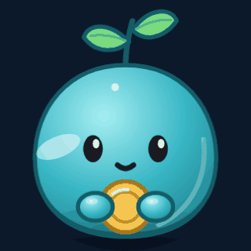
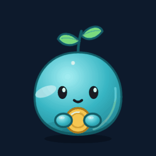
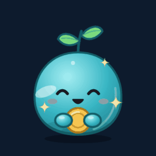
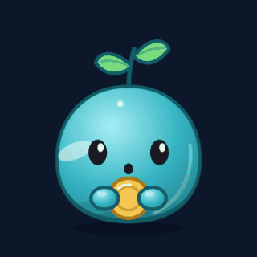
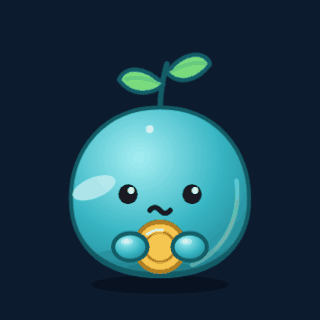
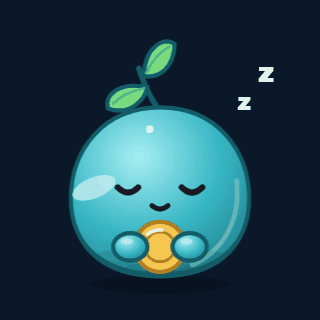
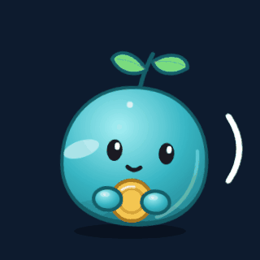
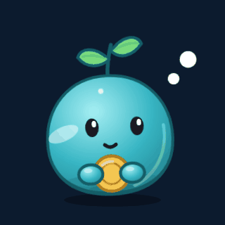
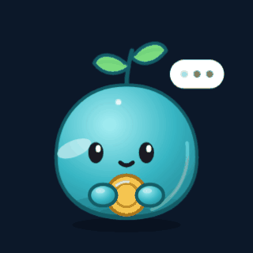

# O personagem

O Tino é um brotinho que guarda moeda: corpo redondo azul-piscina, um broto de
duas folhas na cabeça e uma moeda no colo. Dinheiro que cresce devagar. É uma
criatura inventada — não é bicho, não é cofrinho, e não deriva de nenhum mascote
existente.

**Sério com o dinheiro, gentil com a pessoa.** O carisma está no rosto e no
movimento; a seriedade está no tom. Ele nunca cobra.

## Estados

Cada estado nasce de um evento real, não de enfeite. O núcleo diz o que
aconteceu (`Evento`); o canal decide como mostrar.

| | Estado | Quando | Fala |
|---|---|---|---|
|  | ocioso | esperando | "Me manda um gasto que eu anoto." |
|  | sucesso | lançamento gravado | "Registrado: **R$ 132,40** em Mercado." |
|  | alerta | valor muito acima do normal da pessoa | "R$ 4.800 em Moradia? Seu normal é 1.800." [Tá certo] [Corrigir] |
|  | erro | não entendeu a mensagem | "Não achei o valor. Manda assim: `23,50 uber`." |
|  | dormindo | lançamento entre 0h e 6h | "Hm… anotado. Vai dormir também." |
|  | ouvindo | mensagem de voz | "Pode falar, tô ouvindo." |
|  | pensando | interpretando | "Deixa eu ver isso…" |
|  | escrevendo | montando a resposta | (digitando…) |

No Discord, os cinco primeiros já aparecem como miniatura de cada resposta. Ouvindo,
pensando e escrevendo ficam para os canais que mostram a espera (voz, site).

## Regra das falas

- **Toda pergunta vem com botões; o que não pede resposta é afirmação.** Pergunta
  sem resposta possível vira cobrança.
- **No alerta, só grava depois da resposta.** Pega o `5000` digitado no lugar de
  `50,00` antes de ele virar histórico.
- **Quem julga o gasto é a pessoa, nunca o bot.**

## Próximos traços

Desenhados, ainda não no código:

| Traço | Regra |
|---|---|
| Planta | o broto cresce com os dias com registro **no total**: broto, brotando, muda, frondosa. Nunca encolhe por gasto |
| Ausência | 5 dias sem registro: triste · 10: se afasta · 15: de costas, espiando. Ao voltar: "Voltou! Senti sua falta." |
| Abraça a moeda | gasto acima de 3× o maior da categoria: "Foi planejado?" [Planejado] [Foi impulso] |
| Esconde a moeda | a pessoa marcou "Foi impulso" ou escreveu `#impulso` |
| Olhada de canto | só em categoria que a pessoa pediu para vigiar, com [Parar de vigiar] |

## Como é feito

SVG desenhado em código, animado só com CSS: cada camada (`<g>`) anima uma coisa
só — respiração, olhar, piscar, broto — e as camadas aninhadas somam os
movimentos. Assim cada estado sai como SVG autocontido, GIF ou PNG, sem
JavaScript. No site, a ideia é usar GSAP para as transições entre estados.
