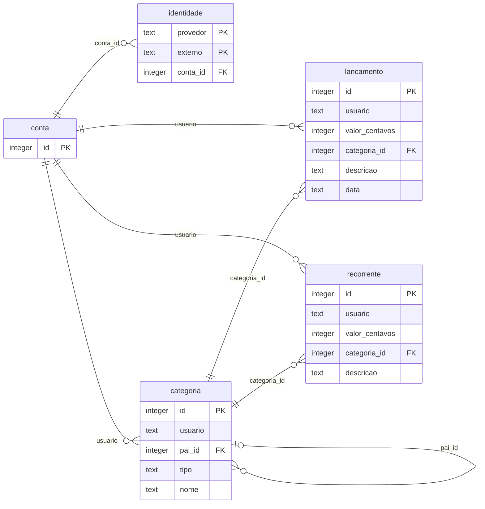

# Banco

SQLite, um arquivo só (`tino.db`), aberto em modo WAL. O esquema é criado no boot com
`CREATE TABLE IF NOT EXISTS`, sem ferramenta de migração enquanto ele couber nisso. As decisões
de código estão em [decisoes.md](decisoes.md).

Um índice só: `idx_consulta ON lancamento (usuario, data)`, que serve a todo resumo e listagem.

## Escolhas

**`usuario` é o id da conta, não do canal.** Uma conta tem várias identidades
(`provedor, externo`): quem lança pelo Discord e entra no site pelo Google vê os mesmos dados
depois de vincular as duas. Vincular uma identidade que já pertence a outra conta é recusado; não
existe fusão de contas.

**Sinal no valor em vez de coluna `tipo`.** Saldo é `SUM(valor_centavos)`, gasto é a soma do que
for negativo. Elimina uma coluna, um enum e todo o código que decidiria quando somar e quando
subtrair.

**Centavos em inteiro.** SQLite não tem decimal, e `double` em dinheiro é bug.

**Subcategoria é `pai_id` apontando para a própria tabela.** O resumo agrupa pela raiz, então uma
subcategoria soma na categoria principal.

**Gasto e ganho são listas separadas**, distinguidas por `tipo`. "Outros" existe nos dois lados,
como categorias diferentes.

**Categoria pertence sempre a alguém.** As iniciais são criadas para a conta no primeiro contato,
e não como registros do sistema: é isso que permite renomear e excluir qualquer uma.

**Nomes em forma canônica** (`Cartão de Crédito`), o que torna a comparação insensível a caixa
mesmo com acento, onde o `COLLATE NOCASE` do SQLite falha.

## Regras que não são negociáveis

Estas falham em silêncio se quebradas, então valem para qualquer código que escreva no banco:

1. Valor maior que zero, com no máximo duas casas (arredondamento `HALF_UP`).
2. Toda query filtra por `usuario`. Sem exceção.
3. Data futura é rejeitada.
4. Categoria só é usada pela dona, e nunca cruza entre gasto e ganho.
5. Comparação com período anterior de total zero mostra `—`, nunca divide por zero.
6. Nada de token ou dado financeiro em log.

Nenhuma delas é constraint do banco: o SQLite aqui não tem `CHECK` nem chave estrangeira para
`usuario`, então quem garante é o núcleo. A 1 e a 3 hoje são checadas na interpretação da entrada
(`Dinheiro`, `Entrada`); levá-las para o `Pedido`, para valerem também em canais que montam o
pedido direto, é trabalho pendente.
